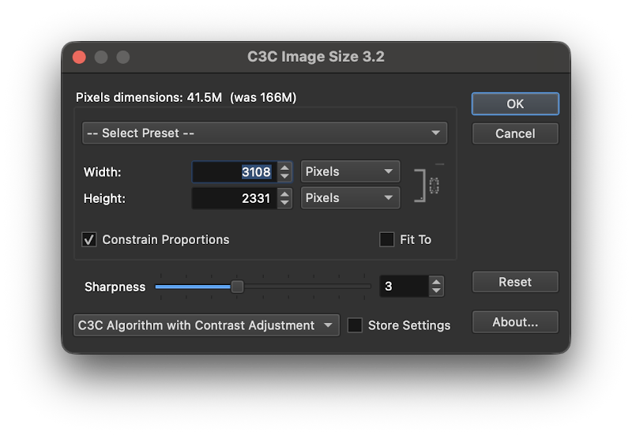
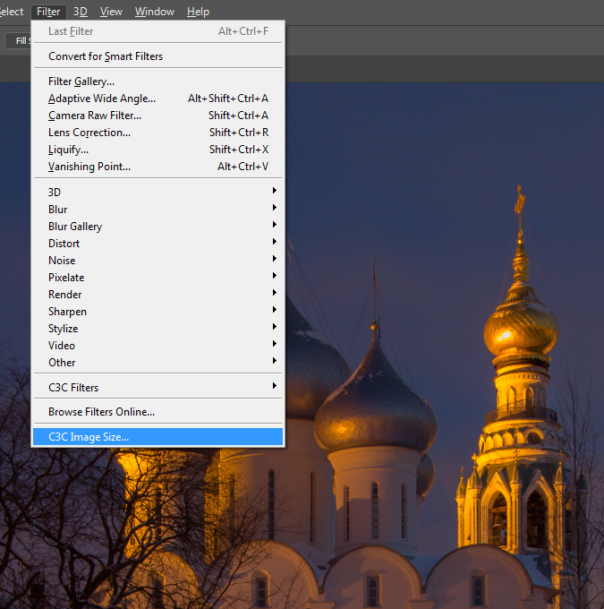
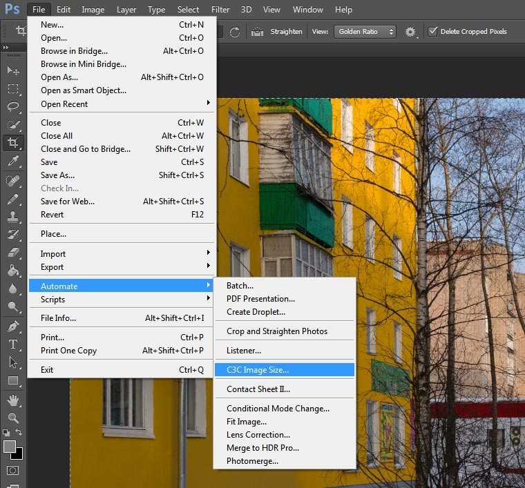
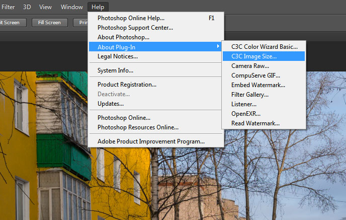

# C3C Image Size

**C3C Image Size** performs high-quality downsizing of raster images. The plug-in is designed for **Adobe Photoshop®** and works in **Windows** and **macOS** operating systems.



*The C3C Image Size plug-in*

Version 3.2.

The plugin sources are released in memory of the original author, Sergey
Sverdlov, and are maintained and enhanced by Alexey Danilchenko.

Prebuilt packages are published in the *Releases* section of this repository.

## What is in the package

The **C3C Image Size** program consists of three parts:

- **C3CImageSize** — the filter plug-in. It is registered in the *Hidden* category, so it does not appear in the Filter menu on its own; it is invoked from the script below or from Photoshop scripts.
- **C3CImageSizeAutomate** — the main automation plug-in. It adds the **C3C Image Size...** action (category *C3C Geometry*), available from the **File/Automate** menu, the Actions panel and from scripts (via its own terminology dictionary).
- **C3CImageSize2FilterScripting.jsx** — a Photoshop script which, once installed, adds **C3C Image Size...** to the **Filter** menu (one click less).

## Basic properties

- The plug-in uses the original image scaling algorithm (**C3C algorithm**) in combination with a simple and effective method of sharpening.
- **Accurate color rendering**: colorimetrically correct color conversions and the **best preservation of details** are guaranteed.
- **High accuracy**, thanks to the use of floating point arithmetic in intermediate calculations.
- **Adjustment of sharpness**, including **automatic** (the sharpness slider set fully to the left), is provided.
- Works with images that contain layers, transparency channels and masks. The **C3C algorithm is applied to the active layer**; the remaining layers, additional channels and masks are scaled by the Photoshop bicubic algorithm.
- The plug-in is intended for downsizing of images presented in **8-bit and 16-bit** modes.
- Works with **RGB and GrayScale** images.
- **Multistep conversion is not required** with a strong resize.
- Works in **Photoshop Actions**.

## How to install and run

### How to install

**Windows**

Copy the contents of the package (the `C3CImageSize.8bf` and `C3CImageSizeAutomate.8bf` plug-ins, the Qt and TBB DLLs and the `platforms` folder) to the place where **Adobe® Photoshop®** plug-ins are located (the `Plug-Ins` folder, or `Plug-PerUser` for a per-user install), keeping the layout intact.


*To install the C3C Image Size plug-in, copy the package contents to the Adobe Photoshop plug-ins folder*

Copy the script **C3CImageSize2FilterScripting.jsx** to the **Adobe® Photoshop®** scripts folder, for example `C:\Program Files\Adobe\Adobe Photoshop <version>\Presets\Scripts`.

**macOS**

Copy the **C3CImageSize.plugin** and **C3CImageSizeAutomate.plugin** bundles to the per-user plug-in folder:

```
~/Library/Application Support/Adobe/Photoshop/Plug-Ins/
```

(or the application-level `Adobe Photoshop.app/Contents/Plug-Ins` for an all-users install).

*Mac version*

Copy the script **C3CImageSize2FilterScripting.jsx** to the **Adobe® Photoshop®** scripts folder, for example `~/Library/Application Support/Adobe/Photoshop/Presets/Scripts`.

Restart Photoshop after installing.

### How to start

If the script is installed, the plug-in can be launched from the **Filter** menu:



*Run the plug-in from the Filter menu when using the C3CImageSize2FilterScripting.jsx script*

Like any automation plug-in, it also runs from the **File/Automate** menu (item **C3C Image Size...**, category *C3C Geometry*):



*Run the C3C Image Size plug-in from the File/Automate menu*

The About dialog is available from the **Help/About Plug-In** menu:



*The About dialog is available from the Help/About Plug-In menu*

### Use in Actions

If you call the plug-in from the **File/Automate** menu when you write Actions, the plug-in window will not open. If you call the plug-in from the **Filter** menu while the Action is being written, the "Toggle dialog on/off" will work.

The **C3C Image Size...** action is scriptable via its own terminology dictionary (suit *C3C Geometry*): width, height, sharpness, resize units (pixels / %) and resize method (C3C linear / C3C linear with contrast).

## System requirements

- **Windows** (64-bit) or **macOS** (Apple Silicon, macOS 15.0 or later).
- **Adobe® Photoshop®** (recent versions; the build is based on the Photoshop 2025+ SDK).

## Algorithm with contrast adjustment

> The images in the examples should be viewed at a scale of 1:1 (pixel by pixel). If you look at pictures at a different scale, you will see the result of scaling by your browser.

In the **C3C Image Size** program, two versions of the image reduction algorithm are used. The main algorithm (**C3C Algorithm**) uses a colorimetrically accurate conversion of color information. But when the image is reduced, the data is averaged. This can reduce the overall contrast of the image. To compensate for this effect, there is a variant of the algorithm that aligns the overall image contrast (**C3C Algorithm with Contrast Adjustment**).

| C3C Algorithm | C3C Algorithm with Contrast Adjustment |
|---|---|
|  |  |

*The photo was obtained by reducing the original (5184×3456) to 800×533 using the C3C Algorithm (left) and the C3C Algorithm with Contrast Adjustment (right)*

## License

The plug-in sources are available under the [MIT License](LICENSE).

## For developers

- [INSTALL.md](INSTALL.md) — build and installation instructions.
- [DEVELOPER_NOTES.md](DEVELOPER_NOTES.md) — project structure, build system and legacy build notes.

## Community

- [Original english manual](https://telegra.ph/C3C-Image-Size-English-12-30)
- [Telegram channel](https://t.me/C3CImageSize)
- [Telegram group](https://t.me/C3CImageSizeChat)
